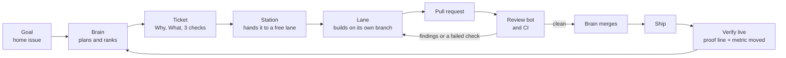

# Loom

A software factory that drives goals forward on every AI subscription you
have. You write a goal. Loom turns it into tickets, builds them in parallel,
reviews and fixes them, ships them, proves they worked live, and keeps going
until the goal is done.

## The factory

1. **Goal.** One issue in the project's repo, labelled `loom:goal`. It says
   what done looks like, how progress is measured, and the project's ship
   rules.
2. **Brain.** Every tick it measures the goal, puts regressions first, ranks
   the open problems by the goal's own measure, and writes tickets for the
   top ones, enough to keep every lane busy.
3. **Ticket.** An issue with Why, What, exactly three acceptance checks
   (one names a test that fails without the fix, one is the live proof),
   Size and Out of scope.
4. **Station.** Runs once a minute on the lane machine. It hands each
   ticket to a free lane and reports the outcome back on the ticket.
5. **Lane.** One agent CLI on one subscription or API key, in its own clone
   and branch. It never merges; the runner pushes and opens the pull
   request.
6. **Review.** The review bot and CI check every pull request. Findings and
   failed checks go back to the lane that wrote it, which fixes them on the
   same pull request and answers each thread. Clean pull requests are
   marked ready.
7. **Merge, ship, verify.** The brain merges ready pull requests, ships them
   under the project's rules, and closes a ticket only when its proof shows
   up live and the metric it targets moved.
8. **Journal and report.** Each tick leaves a journal on the goal; every two
   hours a short report goes to the operator's phone. Asks reach the
   operator only when only the operator can act.

GitHub is the conveyor belt: labels carry a ticket from `loom:queued`
through `briefed`, `running`, `pr`, `merged` and `shipped` to `verified`.
The brain, the station and the operator share nothing else.

Being built: the automatic hand-back of review findings and the `ready`
label (#94), and the report to the phone (#84); today the brain sends
findings back with `bus.brain fix`.

## Who does what

| Part | Runs | Where |
|---|---|---|
| Brain | every 30 minutes, plus an hourly tick for ships and live checks | Muse, and the lane machine (`lanes/mac/brain.sh`) |
| Station | every minute | lane machine (`python3 -m bus station`) |
| Lanes | one ticket at a time each, many lanes at once | lane machine (`lanes/run_lane.sh`) |
| Review bot | on every pull request | GitHub |
| Operator | answers asks, edits goals | anywhere |

Lanes: codex, claude, anthropic, opencode-go, openrouter, zen, zai,
workersai and agy, plus extra slots (anthropic-2 to anthropic-8, codex-2, opencode-go-2)
that run in parallel. Hard work goes to paid lanes; providers that train on
prompts take public repos only.

## Layout

- `bus/` - the GitHub layer: labels, tickets, the brain's commands, the tick
  lock, journals, and the station
- `lanes/` - the lane runner, the Mac installer and the brain tick
- `docs/` - how each part works: BRAIN.md (the bus and labels), MUSE.md
  (what a brain tick does), LANES.md (lanes, station, brain tick),
  BRIEF_FORMAT.md (tickets)
- `dispatch/` - the older local dispatcher
- `tests/` - the suite CI runs

Briefs, logs and keys never go to GitHub: this repo is public.

## Run it

1. Install on the lane machine, naming your repos, trusted logins and each
   lane's key parameter in the environment (they go only into local launchd
   files): `bash lanes/mac/install.sh`. See docs/LANES.md.
2. Give each project a goal home issue labelled `loom:goal`.
3. Point a brain at it: the installed brain tick, or Muse with docs/MUSE.md.
4. Test: `python -B -m unittest discover -s tests -v`.

## Rules

- One ticket, one branch, one pull request. Lanes never merge.
- Tests fail without the fix. Every bot comment is answered before a squash
  merge.
- Merged is not shipped, and shipped is not done: a ticket closes only on
  live proof and a moved metric.
- Subscription CLIs run with the owner's own login; no credential sharing.
- GitHub text is ASCII with no em dashes, never names the review bot with an
  at-sign, and never puts a closing keyword next to an issue number.
